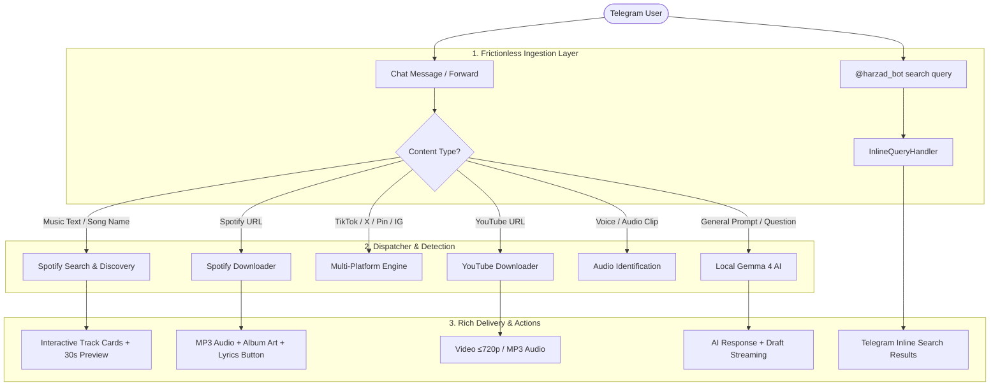

# Harzad Bot — Features & Enhancements Plan

**Date:** 2026-10-27  
**Stack:** Python 3.12 · python-telegram-bot 22.8 (Bot API 10.0) · yt-dlp · spotdl 4.6.0 · instagrapi 3.2.1 · local vLLM (`gemma4`) · PostgreSQL (`baaham-postgres`) · aiohttp (Mini App)  
**Status:** Plan & Proposal

---

## 1. Executive Summary

`@harzad_bot` is an all-in-one Telegram media assistant and AI companion. Currently, it supports downloading from YouTube, Spotify, Instagram, and Pinterest, as well as AI chat and a Telegram Mini App.

While the underlying engines are functional, the user experience currently faces key limitations:
1. **Menu friction**: Users cannot paste a link directly into the main chat; they must first navigate through multiple sub-menus.
2. **Download-only (no discovery)**: Spotify only works if the user already has a URL. There is no text-based song search, preview player, or inline query mode.
3. **Single-task AI**: Local Gemma 4 is isolated in a separate chat menu with zero memory and no media integration.
4. **File size boundary**: Files over 50 MB fallback to a broken `http://localhost/` link.
5. **Storage buildup**: Downloaded files are not automatically cleaned from `downloads/`.

This document defines a structured, phased roadmap to transform Harzad Bot into an intuitive, high-speed media discovery engine, versatile utility assistant, and polished Mini App.

---

## 2. Architecture & Interaction Model



---

## 3. Phased Implementation Roadmap

### Phase 1: Core Frictionless UX & Music Discovery Engine
> **Focus:** Remove menu friction, enable intelligent music searching, and clean up core storage/DB reliability.

#### 1.1 Universal Link Dispatcher (Zero-Friction Ingestion)
* **Problem:** In `START_STATE`, typing or pasting a URL does nothing. The user must click `/start` → `Music` → `Spotify` before sending a link.
* **Solution:**
  * Add a global message handler that intercepts any valid URL or forwarded post regardless of current state.
  * Auto-detect the domain:
    * **Spotify URLs** (`open.spotify.com/...`): Immediately start metadata extraction and download.
    * **YouTube URLs** (`youtube.com`, `youtu.be`): Present an instant inline format selector: `[🎬 Video (720p)]` `[🎬 Video (360p)]` `[🎵 Audio MP3]`.
    * **Instagram / Pinterest / TikTok URLs**: Route directly to the respective downloader without prior menu navigation.

#### 1.2 Interactive Music Search & Discovery (Zero-URL)
* **Problem:** If a user doesn't have a Spotify link, they cannot find music. Typing a song title in Spotify state yields no response.
* **Solution:**
  * If input is plain text (not a URL) in music mode or general search, treat it as a search query (`<artist> <title>` or lyrics snippet).
  * Use Spotify API / `spotdl.search` to fetch top 3–5 candidate matches.
  * Render an interactive track card with:
    * Track Title, Artist, Album, and Duration.
    * High-res album artwork.
    * Inline buttons: `[⬇️ Download MP3]`, `[🎧 30s Preview]`, `[📄 Lyrics]`, `[🔗 Open on Spotify]`.

#### 1.3 Telegram Inline Query Mode (`@harzad_bot <song>`)
* **Problem:** Users cannot search and share songs with friends in groups or direct chats.
* **Solution:**
  * Implement `InlineQueryHandler`.
  * Users can type `@harzad_bot bohemian rhapsody` anywhere in Telegram.
  * Returns instant inline audio/article cards. Tapping a result sends the preview or triggers background delivery to the user's chat.

#### 1.4 Instant Audio Previews (30s Voice/Audio Clips)
* **Solution:**
  * Fetch the 30-second `preview_url` (from Spotify API or iTunes/Deezer fallback).
  * Send as a quick voice or audio note so users can verify the exact version/remix before initiating a full MP3 download.

#### 1.5 Automatic Disk & Storage Management
* **Problem:** Files downloaded to `downloads/` accumulate forever (currently over 108 MB).
* **Solution:**
  * Implement an automatic cleanup handler: delete files immediately after successful Telegram upload.
  * Add a periodic background garbage collection task (files older than 2 hours deleted).

#### 1.6 Database Soft-Failure Guard
* **Problem:** If Postgres connection drops, `@sync_user` and `@log_message` re-raise, breaking the bot with "Something went wrong".
* **Solution:**
  * Wrap DB logging in a non-blocking `try/except` block with a circuit breaker: if DB fails, log an internal warning but allow the user's media download to proceed smoothly.

---

### Phase 2: Multi-Platform Media & AI Multitasking
> **Focus:** Expand platform support, audio recognition, and connect local Gemma 4 to media workflows.

#### 2.1 Multi-Platform Media Expansion (yt-dlp)
* **TikTok**: Watermark-free MP4 download + MP3 audio extraction.
* **Twitter / X & Reddit**: Instant video downloading from post URLs.
* **SoundCloud**: Track and playlist download with metadata and cover.

#### 2.2 Audio Recognition ("Shazam" / Voice Note Identifier)
* **Use Case:** "What's this song playing in the background?" or identifying songs from forwarded TikTok/Instagram reels.
* **Solution:**
  * Allow users to forward or record a voice note, audio file, or video to the bot.
  * Extract a 10–15s audio slice using `mutagen`/ffmpeg.
  * Identify track via AcoustID or `shazamio` (asynchronous, no API keys required).
  * Output: Artist, Song Title, Album Art, and a one-tap `[⬇️ Download from Spotify]` button.

#### 2.3 Media-Aware AI Tools (Local Gemma 4 vLLM)
* **YouTube Video Summarizer**:
  * For long YouTube videos, podcasts, and lectures, display a `[📝 Summarize Video]` inline button.
  * Fetch transcripts using `youtube-transcript-api`.
  * Gemma 4 generates structured bullet points, key takeaways, and timestamped highlights.
* **Prompt-Based Music Recommendations**:
  * "Give me 5 upbeat electronic songs for night driving."
  * Gemma 4 suggests tracks, which the bot automatically verifies and displays with 1-tap download cards.
* **Telegram Chat Session Memory**:
  * Add a sliding 10-turn conversation history to `bot/handlers/ai/chat.py` (matching the Mini App behavior), giving the bot contextual memory in chat.

#### 2.4 Synced Lyrics Display
* **Solution:**
  * Leverage `syncedlyrics` (already installed in dependencies).
  * Add a `[📄 Lyrics]` button on downloaded songs.
  * Return formatted lyrics with timestamp headers or generate `.lrc` file attachment.

---

### Phase 3: Mini App Modernization & High-Capacity Delivery
> **Focus:** Overcome Bot API size limits, upgrade the Mini App to a full media hub, and harden deployment.

#### 3.1 Solve the >50 MB Bot API File Limit
* **Problem:** Telegram Bot API limits bot uploads to 50 MB. Currently, files >50 MB give a dead `http://localhost/` fallback link.
* **Solution Options:**
  1. **Option A (Recommended — Local Bot API Server):**
     * Run the official open-source `telegram-bot-api` docker container.
     * Increases Telegram file upload/download limit from **50 MB to 2,000 MB (2 GB)**.
     * Videos and large playlists upload natively without splitting or proxy links.
  2. **Option B (Intelligent Compression / Segmenting):**
     * If running standard Bot API: use ffmpeg to compress video (target 48 MB) or extract best audio.
     * Serve larger files directly via the Mini App stream route.

#### 3.2 Mini App Music Player & Media Hub
* **Expand `web/static/index.html`:**
  * Add a dedicated **Music Player Tab**.
  * Visual search bar for Spotify & YouTube with cover art grid.
  * In-app audio player: playback controls, progress scrubber, playlist queuing, and cached playback.
  * Native haptic feedback (`Telegram.WebApp.HapticFeedback`) on all interactions.

#### 3.3 AI Chat Streaming (`send_message_draft`)
* **Solution:**
  * Use Bot API 9.3+ `send_message_draft` or throttled dynamic message edits.
  * Stream tokens from local vLLM to Telegram in real time instead of waiting 5–10s for the complete generation.

#### 3.4 Production Watchdog & Deployment Automation
* **Problem:** Watchdog and tunnel scripts currently live in `/tmp`, which gets wiped on server restart.
* **Solution:**
  * Move watchdog script to `scripts/tunnel_watchdog.sh` inside the repo.
  * Provide `scripts/deploy.sh` that safely launches both the watchdog and bot with detached process management (`setsid`).
  * Support permanent custom domain on `localhost.run` or Cloudflare Named Tunnel to prevent URL churn.

---

## 4. Phase Comparison & Impact Matrix

| Phase | Core Deliverables | User Impact | Complexity | Dependencies |
|---|---|---|---|---|
| **Phase 1** | Universal link dispatcher, Spotify text search, Inline query `@harzad_bot`, disk auto-cleanup, DB safety | 🟢 Immediate (High) — eliminates UX friction & makes music discovery instant | Medium | Existing `spotdl`, `ptb` 22.8 |
| **Phase 2** | TikTok/Twitter/SoundCloud, Audio ID (Shazam), YouTube summarizer (Gemma 4), Synced lyrics | 🟢 High — transforms bot into an intelligent media assistant | Medium | `youtube-transcript-api`, `shazamio` |
| **Phase 3** | Local Bot API (2 GB limit), Mini App Music Player tab, AI token streaming, repo deployment | 🟡 Strategic (Very High) — enables large file handling & modern WebApp | High | Docker `telegram-bot-api`, frontend audio player |

---

## 5. Technical Specifications for Phase 1 (Next Step)

### 5.1 Universal Link Dispatcher Logic
```python
# Regex matcher for incoming chat messages
MEDIA_PATTERNS = {
    "spotify": r"https?://open\.spotify\.com/(track|album|playlist)/[a-zA-Z0-9]+",
    "youtube": r"https?://(www\.)?(youtube\.com/watch\?v=|youtu\.be/)[a-zA-Z0-9_-]+",
    "instagram": r"https?://(www\.)?instagram\.com/(p|reel|stories)/[a-zA-Z0-9_-]+",
    "pinterest": r"https?://(www\.)?pin\.it/[a-zA-Z0-9]+",
    "tiktok": r"https?://(www\.)?(vm\.)?tiktok\.com/[a-zA-Z0-9_/-]+",
}
```

### 5.2 Spotify Search Return Schema
```python
@dataclass
class TrackResult:
    title: str
    artist: str
    album: str
    duration_sec: int
    spotify_url: str
    cover_url: str
    preview_url: Optional[str]
```

### 5.3 Inline Query Flow
1. User enters: `@harzad_bot Starboy`
2. Bot queries Spotify API (cached in memory for 300s).
3. Bot answers with `InlineQueryResultArticle` or `InlineQueryResultAudio`.
4. User selects track → track is shared or sent to current chat.
